<p align="center">
  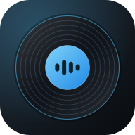
</p>

<h1 align="center">Spindle</h1>

<p align="center">
  A web remote and library browser for <a href="https://github.com/bjarneo/cliamp">cliamp</a>, the retro terminal music player.<br>
  Control playback, browse Navidrome and radio, watch a record spin on your TV, and make it look like a Walkman, a Winamp skin or a PlayStation.
</p>

<p align="center">
  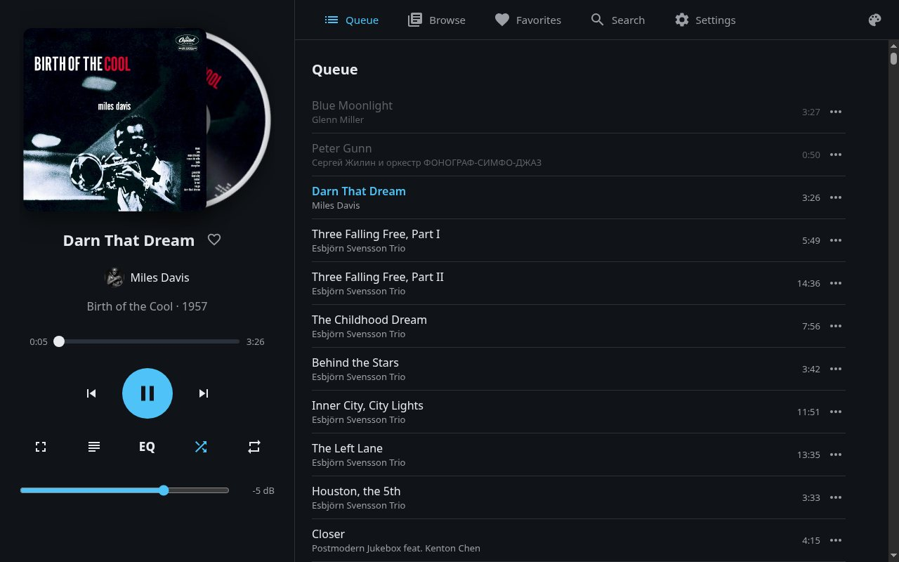
</p>

Spindle is a small Go program (the *bridge*, binary name `spindle`) plus a
self-contained web page it serves. The bridge talks to cliamp over its local
IPC socket, so the page stays in step with the terminal player in both
directions. There is no login and no JavaScript toolchain: the page is plain
HTML, CSS and JS embedded in the binary.

```
browser ──HTTP / SSE──▶ spindle (the bridge, default port 8730)
                            │  cliamp.sock  (cliamp V2 IPC)
                            ▼
                          cliamp  ◀── spindle.lua plugin starts and supervises the bridge
```

## Screenshots

| Browse your library | An album | Radio with logos and filters |
|---|---|---|
| 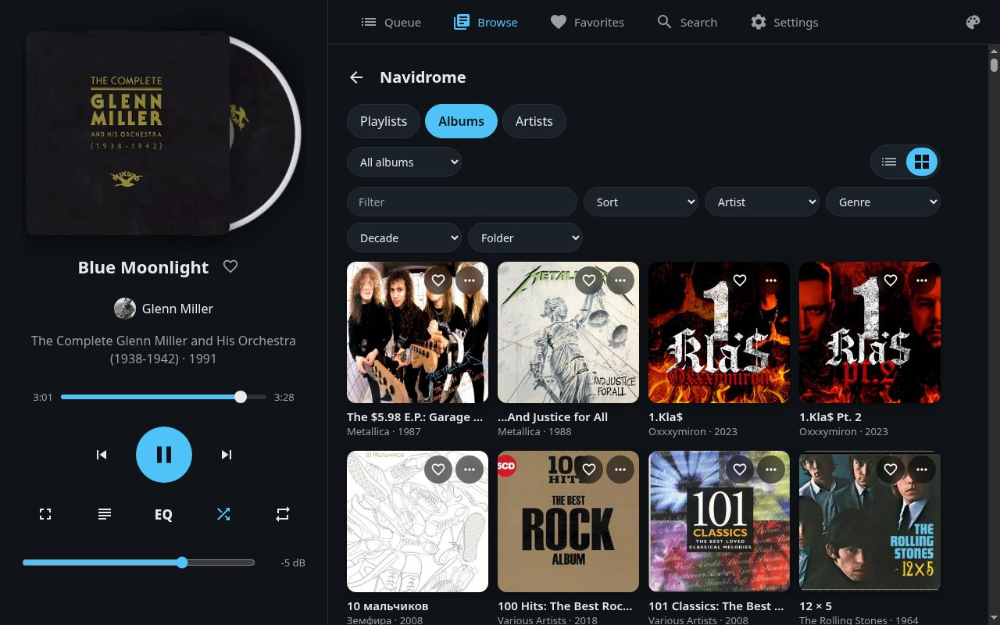 | 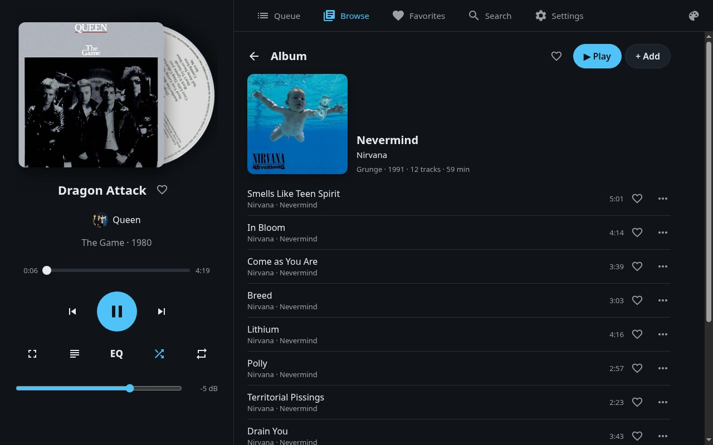 | 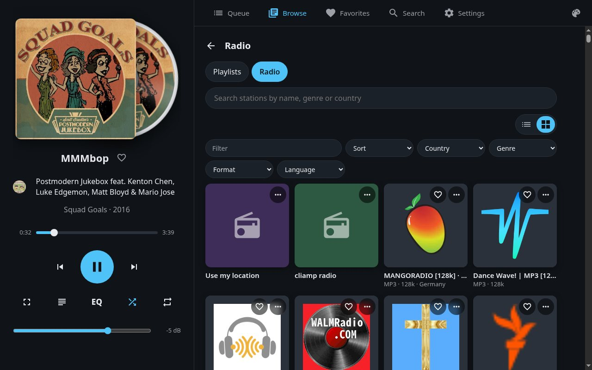 |

**Fullscreen on a TV**: cover and spinning disc side by side, large text, tech line, next track. Controls fade out when nobody is touching anything.

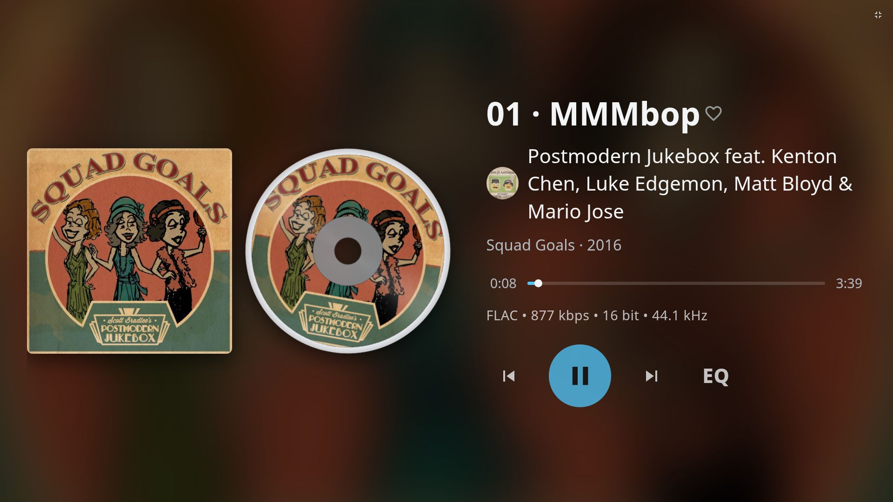

| On a phone | | | |
|---|---|---|---|
| 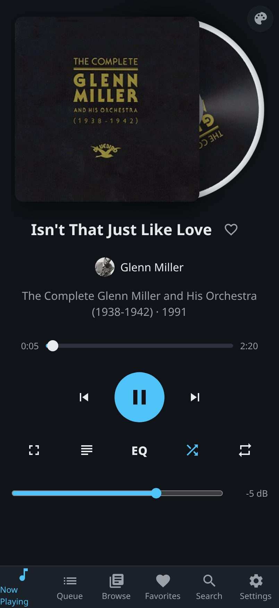 | 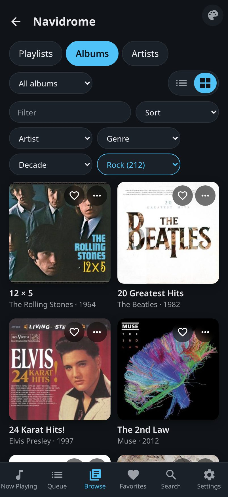 | 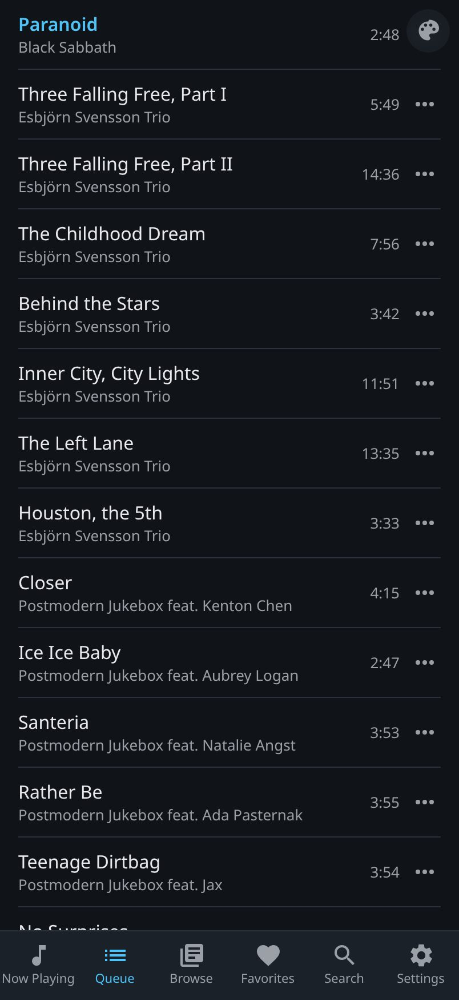 | 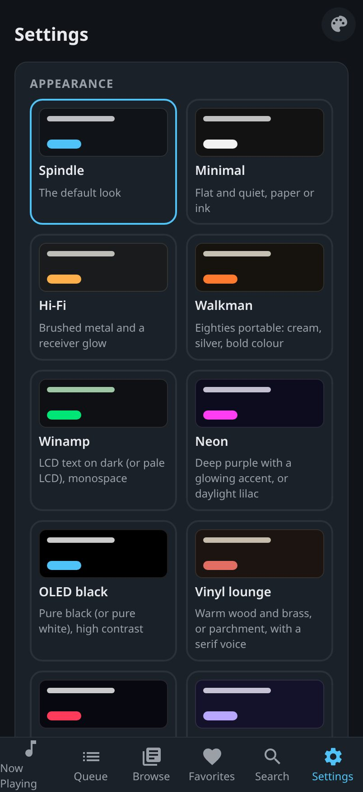 |

**Eleven themes**, each with a light and a dark version and several colours. A theme restyles the buttons, bars, icons and fonts, not only the colours.

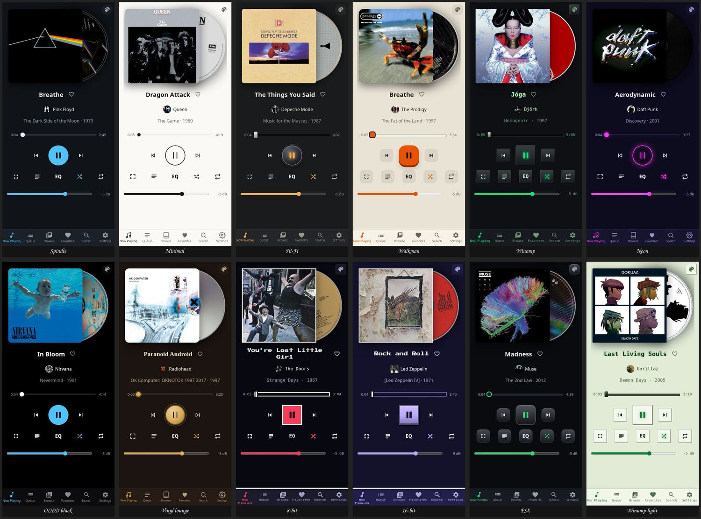

| Radio directory search | Equalizer menu | Theme menu |
|---|---|---|
| 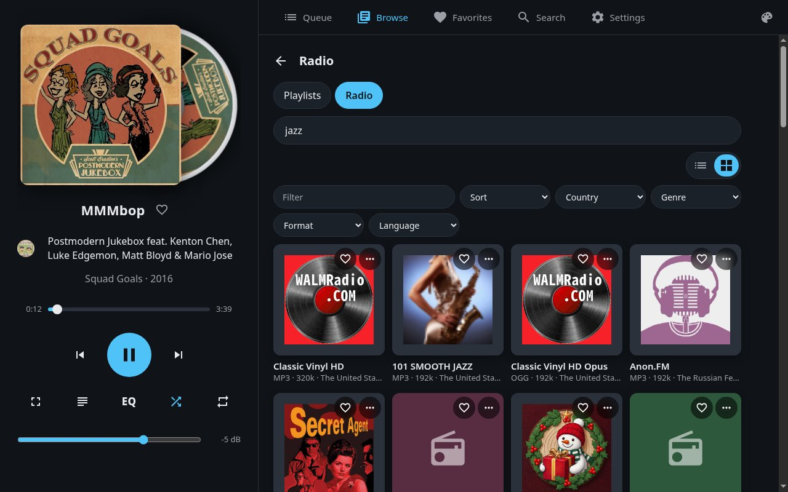 | 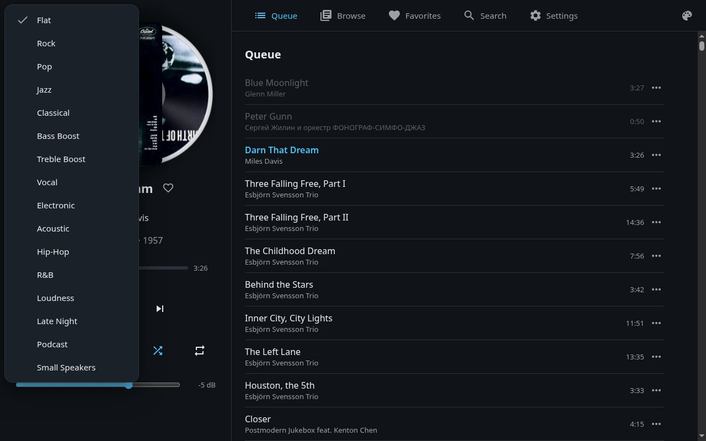 | 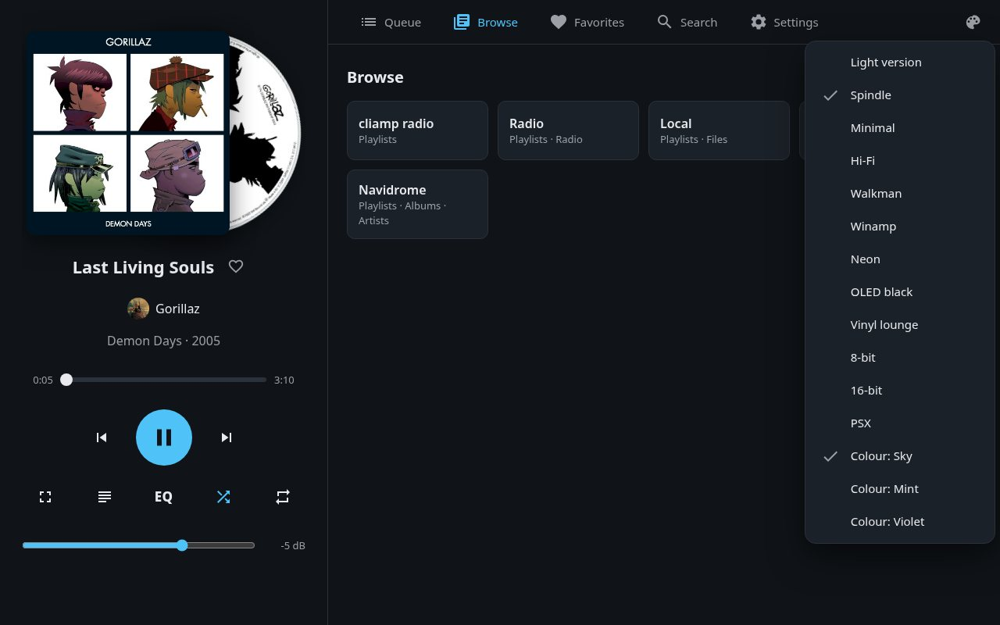 |

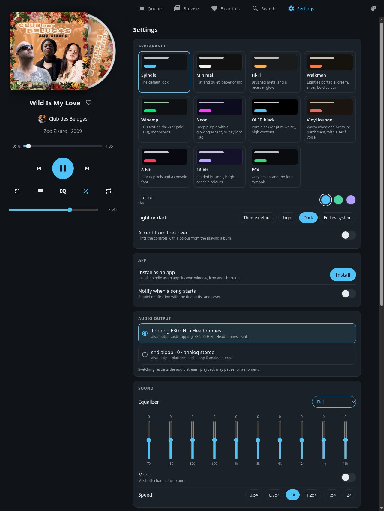

## Features

### Playback
- Now Playing with cover, a disc that spins at 33⅓ rpm and brakes realistically when you pause, artist photo, drag-to-seek bar, volume in dB, shuffle and repeat (with tooltips that say what a click does).
- Both directions stay in sync: change something in the terminal player and the page follows within about a second, and the other way round.
- Synced lyrics with the current line highlighted; tap a line to jump to it.
- **Fullscreen player** for tablets and TVs: blurred cover backdrop, cover and disc side by side on wide screens, `04 · Title`, album and year, progress, a tech line (`FLAC • 1161 kbps • 16 bit • 44.1 kHz`), the next track, and controls that hide after a few seconds of no mouse, touch, key or gamepad activity. Text scales with the screen so it reads across a room.
- Smooth disc and cover animations when you skip tracks, with a different motion for next and previous.

### Library
- **Browse every provider** cliamp has: Navidrome, local, podcasts, radio, and so on. Albums, artists, playlists and a radio catalog adapt to what each provider offers.
- **Tiles or list** for every collection, remembered per list, with **infinite scroll** (no "load more" buttons).
- **Sort, filter and search inside lists**: text filter everywhere; albums sort by name, artist, release year or track count and filter by artist, genre, decade and folder; artists sort by album count; the provider's own orders (newest, recently played, most played, starred) are one click away.
- **Album pages** show the cover, artist, year, genre, track count and length above the tracks. Hovering an album tile reveals a big Play button and an Open button.
- **Real covers everywhere**: Navidrome albums, artists and playlists by id, embedded and folder art for local files, folder thumbnails in the file browser, a synthetic disc when an album has none.
- **File browser** over cliamp's music folder with Play and Add to queue for any folder or file, plus a **Folder filter** that tells apart parts of your tree (for example `Rus`, `French`, `Rock`).
- **Search** every searchable provider.

### Radio
- Station tiles with **logos** found in the public Radio Browser directory (or the stream's own ICY headers), **format, bitrate and country** on every tile, and a **directory search** by name, genre or country.
- Filters for country, genre, format and language, sorting by popularity or bitrate, and offline stations hidden by default.
- Live **song titles** from the stream shown as title and artist, with the station underneath.

### Queue and favorites
- One **"…" menu on every item** (tracks, albums, artists, playlists, stations, queue rows): **Play** (clears the queue and plays), **Add to queue**, favorite. It is a popover on wide screens and a bottom sheet on phones, and works from the keyboard.
- Adding an artist or a 12,000-track playlist runs in the background with progress and a Stop button.
- **Favorites** for tracks, albums, artists, playlists and radio stations, synced with cliamp's own favorites where it has them.
- A single **Queue** list: played tracks greyed out, the playing one marked, play-next entries first; move, remove and play from here.

### Sound and settings
- **Settings page**: audio output device, equalizer (16 presets and ten bands), mono and playback speed; providers and what they can do; about information; and the choices of this browser.
- **EQ button** on Now Playing and fullscreen opens a preset menu.
- Back arrows go to the page you came from (an artist's albums, not the full list).

### Themes
Spindle, Minimal, Hi-Fi, Walkman, Winamp, Neon, OLED black, Vinyl lounge, 8-bit, 16-bit and PSX. Each has light and dark, colour options, its own button and bar shapes, and some its own icon set (thin line or pixel art). A palette button in the top corner switches them; "accent from the cover" tints the controls with a colour from the playing album. The choice is stored in the browser, so a phone and a TV can differ. See [Themes](#themes-1).

### Installable and notifications
- **Install it as an app** (Settings → App → Install, or your browser's menu): its own window and icon, shortcuts to Queue, Browse and Search, and the page shell loads even when the network is slow. It needs a secure address (HTTPS), see [Installing as an app](#installing-as-an-app-and-notifications).
- **Optional notifications** when a new song starts: a quiet one with the title, artist and cover, only while the page is in the background (or always, your choice). Off by default.

## Requirements

- [cliamp](https://github.com/bjarneo/cliamp) with the V2 IPC, tested with **v2.4.0** (the Lua plugin runs in the TUI, and in `--daemon` mode from v2.2). In daemon mode cliamp does not offer terminal theme and visualizer changes, which Spindle does not use.
- To build: Go 1.23 or newer. Nothing else: no Node, no bundler.
- Linux (x86-64, ARM64, ARMv7) or macOS for the bridge (`make release` builds all of them). Windows is not supported yet: the bridge's socket check uses Unix-only calls.
- A browser with ES2020 and SSE, which means any current phone, tablet or desktop browser.
- Optional: a Navidrome server configured in cliamp (for covers by id and the Folder filter you need the music folder reachable from the machine running the bridge).

## Install

The usual setup is **the spindle.lua plugin starts the bridge whenever cliamp starts**. You need the `spindle` binary and the plugin file.

### 1. Get the binary

Tagged releases on GitHub carry ready binaries (Linux x86-64, ARM64 and ARMv7, macOS) with checksums, plus `spindle.lua`. Or build it yourself (any machine with Go; add `GOOS`/`GOARCH` to cross-compile):

```sh
git clone https://github.com/dimitriuz/Spindle.git && cd Spindle
make build                       # -> dist/spindle
sudo install -m755 dist/spindle /usr/local/bin/spindle
```

For a Raspberry Pi (64-bit OS) build on your computer and copy it over:

```sh
GOOS=linux GOARCH=arm64 CGO_ENABLED=0 go build -o spindle ./cmd/spindle
scp spindle pi@raspberrypi.local:/tmp/
ssh pi@raspberrypi.local 'sudo install -m755 /tmp/spindle /usr/local/bin/spindle'
```

On Arch Linux there is a `PKGBUILD` in the repository (`makepkg -si`).

### 2. Install the plugin

```sh
mkdir -p ~/.config/cliamp/plugins
cp spindle.lua ~/.config/cliamp/plugins/spindle.lua
```

(cliamp may also install it with `cliamp plugins install dimitriuz/Spindle`; this is untested.)

### 3. Allow it and trust it

Edit `~/.config/cliamp/config.toml`:

```toml
[plugins]
allowed_binaries = "spindle"

[plugins.spindle]
port = 8730      # default
lan  = true      # listen on the network; false = this machine only
```

Then, once: `cliamp plugins trust spindle`.

### 4. Start cliamp and open the page

Start cliamp. It shows the address, or read it from the status file:

```sh
jq -r .url ~/.local/share/cliamp/spindle/status.json     # e.g. http://192.168.1.20:8730
```

Open that address on your phone or computer. Add it to the home screen if you like.

### Running cliamp as a service (Raspberry Pi and other always-on players)

If cliamp runs headless on a Pi, a systemd **user** service keeps it (and with it the bridge) up:

```ini
# ~/.config/systemd/user/cliamp.service
[Unit]
Description=cliamp

[Service]
ExecStart=/usr/local/bin/cliamp --daemon
Restart=on-failure

[Install]
WantedBy=default.target
```

```sh
systemctl --user enable --now cliamp
loginctl enable-linger "$USER"          # keep it running without a login session
```

Two things worth knowing:

- Restarting cliamp itself clears its live queue (cliamp does not save it). To update the bridge, replace the binary and stop only the bridge: `sudo install -m755 spindle /usr/local/bin/spindle; pkill -x spindle`. The plugin starts it again within seconds with the new binary and the queue is untouched.
- The plugin restarts a crashed bridge at most three times per cliamp session (it forgives earlier crashes after a minute of stable running). If you kill the bridge repeatedly while testing, it stops restarting; start it by hand (`spindle serve --lan &`) or restart cliamp.

### Running the bridge without the plugin

```sh
spindle serve --lan
```

| Flag | Default | Meaning |
|---|---|---|
| `--port N` | `8730` | HTTP port |
| `--lan` | off | listen on all interfaces (`--bind ADDR` picks one) |
| `--socket PATH` | `~/.config/cliamp/cliamp.sock` | cliamp's IPC socket |
| `--data-dir DIR` | `~/.local/share/cliamp/spindle` | status file and the picture cache |
| `--music-dir DIR` | cliamp's `initial_directory`, else `~/Music` | root of the file browser |
| `--verbose` | off | log to stderr |

The bridge also reads two things from cliamp's `config.toml` so you configure nothing twice: `initial_directory` (the music folder) and the `[navidrome]` login (`url`, `user`, `password`), which it uses only to fetch cover images from your own server. The login is never logged and never sent to the browser.

### Behind a reverse proxy (HTTPS and a nice name)

The bridge accepts any `Host`, so a proxy just works. The event stream must not be buffered; the bridge already sends `X-Accel-Buffering: no`, which nginx and openresty honour. A Caddy example:

```
spindle.example.lan {
    reverse_proxy 192.168.1.20:8730
}
```

## Installing as an app and notifications

Browsers only offer to install a web app, and only allow notifications, on a **secure address**: `https://…`, or `http://localhost`. A plain `http://192.168.1.20:8730` address works for everything else but not for these two. Put Spindle behind an HTTPS reverse proxy (see above), then open it through that address. Settings → App tells you what is missing.

**Install**
- Chrome, Edge and other Chromium browsers (desktop and Android): Settings → App → **Install**, or the install icon in the address bar.
- iPhone and iPad (Safari): Share → **Add to Home Screen**.
- Once installed it opens in its own window and has shortcuts (long-press the icon): Queue, Browse and Search.

**Notifications**
- Settings → App → switch on **Notify when a song starts**, and allow the permission when the browser asks. Choose *Only in the background* (default) or *Always*. **Send a test** checks that it works.
- For a radio station the notification follows the stream's song title.
- The page has to be open: Spindle sends the notification itself, from the page, as the song changes. A page the browser has closed or frozen (a phone with the screen off for a while) cannot notify, because pushing to a closed page would need an internet push service, which a LAN-only player does not use.
- The notification is silent and replaces the previous one; tapping it brings the app forward.

## Using it

| Where | What |
|---|---|
| **Now Playing** | transport, seek, volume, shuffle, repeat, lyrics, **EQ**, fullscreen |
| **Queue** | the queue and play-next list; tap to play, "…" to move or remove |
| **Browse** | providers, collections as tiles or list, files, radio |
| **Favorites** | everything you hearted, filtered by kind |
| **Search** | search a provider; for Radio it searches the whole public directory |
| **Settings** | themes, install and notifications, output device, equalizer, library and about |
| **Palette button** (top corner) | theme, colour, light or dark |

Tips: tap the cover to flip between cover and disc; long lists keep loading as you scroll; the filter box and the drop-downs above a list work on everything loaded so far (artists, albums and playlists load completely in the background).

## Themes

Pick one with the palette button in the top corner, or in **Settings → Appearance**. Each theme has colour options, a light and a dark version, and can follow the system's light or dark setting.

| Theme | Character |
|---|---|
| Spindle | the default look |
| Minimal | flat, ghost buttons, thin line icons |
| Hi-Fi | brushed metal, a knob for play, an amber glow |
| Walkman | cream, chunky keys that press down |
| Winamp | LCD text, bevelled keys, monospace |
| Neon | glowing outlines, line icons |
| OLED black | pure black (or pure white) for maximum contrast |
| Vinyl lounge | wood and brass, serif headings, line icons |
| 8-bit | blocky pixels, console font, pixel icons (NES, Game Boy, blue, amber) |
| 16-bit | shaded bevelled buttons, pixel icons (lilac, Mega Drive blue, orange, jade) |
| PSX | grey bevelled pads and the four symbols |

Themes are plain data in `webui/themes.js`, icon sets in `webui/icons.js`, and the shape of controls is the `html[data-skin=…]` rules at the end of `webui/app.css`. To add a theme, add an entry with its colours (light and dark), its colour options and a `look`; a test checks that every theme, option and mode stays readable. The 8-bit and 16-bit headings use the Press Start 2P font (SIL Open Font License, in `third_party/`).

## How it works

- The bridge connects to cliamp's socket, keeps a cached copy of the player state and queue, and pushes changes to every browser over **Server-Sent Events** (`/api/events`). The page reconnects by itself after a lid close, a bridge restart or a phone sleeping.
- Commands go through `POST /api/command`, which forwards **only the operations the page uses**: transport, volume, shuffle, repeat, queue and play-next edits, provider loads, and the settings operations (`device`, `eq`, `mono`, `speed`) with their parameters checked.
- Multi-step actions (Play or Add to queue for an album, artist, playlist, folder) run in the bridge, one item at a time, with progress events and a Stop button.
- Pictures are fetched once, cached on disk (200 MB, least recently used goes first) and served with ETags. Station logos come from the public [Radio Browser](https://www.radio-browser.info/) directory.
- Stream URLs that carry a login are scrubbed before anything reaches the browser; the bridge keeps the original and swaps it back in when you play.

<details>
<summary>HTTP API (for scripts)</summary>

| Endpoint | Purpose |
|---|---|
| `GET /api/state`, `/api/queue`, `/api/capabilities`, `/api/about` | player state, queue, cliamp's operations, bridge information |
| `GET /api/events` | event stream: `state`, `playback`, `playlist`, `job`, `player`, `favorites`, `enqueue`, `resync`, `ping` |
| `POST /api/command` | `{"op": "...", "params": {...}}` for the allowed operations |
| `GET /api/library/providers`, `/api/library/{provider}/{playlists\|albums\|artists\|catalog}` | browsing (`offset`, `limit`, albums also `sort`) |
| `GET /api/library/{provider}/{album\|artist\|playlist}/{id}/tracks`, `.../artist/{id}/albums` | drill-down |
| `GET /api/search/{provider}?q=`, `GET /api/lyrics` | search and lyrics |
| `POST /api/enqueue`, `POST /api/enqueue/cancel` | Play / Add to queue for tracks, albums, artists, playlists, files, folders |
| `GET\|PUT /api/favorites` | favorites |
| `GET /api/files`, `/api/files/root`, `/api/files/groups`, `/api/files/art` | the music folder |
| `GET /api/art/{cover\|disc\|artist}`, `/api/art/item`, `/api/art/station`, `/api/trackinfo` | pictures and tech info |
| `GET /api/radio/search`, `POST /api/radio/meta` | radio directory |
| `GET /api/health` | liveness |

</details>

## Security and privacy

There is **no login**: Spindle is built for a trusted home network, and anyone who can reach the port can control playback. Do not expose it to the internet; if you need remote access, put it behind a reverse proxy that adds authentication.

What it does guard against:

- It listens on `127.0.0.1` unless you opt in with `--lan` / `lan = true`.
- State-changing requests must be `application/json` from the same origin, so a web page open on your network cannot fire commands at it.
- `/api/command` refuses everything except the operations listed above; plugin calls, URL loading and destructive operations are not reachable. Requests are rate limited per client.
- The file browser is confined to your music folder (no `..`, no symlinks out of it) and never returns absolute paths.
- Logins in stream URLs and in cliamp's config are never sent to the browser, logged, or put in error messages or cache file names.

Outside services: radio station names and stream addresses are sent to the public Radio Browser directory to find logos and details, and your browser loads nothing from third parties. Spindle has no analytics.

## Development

```sh
make build     # dist/spindle (embeds webui/, no JS toolchain)
make test      # go vet + go test + node webui/app_test.js
```

- `cmd/spindle`: the program; `internal/`: IPC, snapshot cache, HTTP server, art, files, favorites, enqueue worker; `webui/`: the page (`index.html`, `app.css`, `app.js`, `themes.js`, `icons.js`, the service worker `sw.js`, icons and manifest); `spindle.lua`: the supervisor plugin.
- The pure half of the page (list sorting, menus, themes, formatting) is tested in plain Node: `node webui/app_test.js`.
- After changing `webui/`, rebuild the binary (the files are embedded) and hard-reload the page.
- Screenshots in this README were taken with headless Chrome against a real player.
- Research notes: [chiptune and tracker formats with cliamp](docs/chiptune-formats.md) (what cliamp can and cannot play, and a ZXTune test).

## Credits and license

MIT, see [LICENSE](LICENSE). Built for [cliamp](https://github.com/bjarneo/cliamp) by bjarneo. Radio logos and details come from [Radio Browser](https://www.radio-browser.info/). The 8-bit and 16-bit themes use the [Press Start 2P](https://fonts.google.com/specimen/Press+Start+2P) font by Cody "CodeMan38" Boisclair (SIL Open Font License 1.1).
