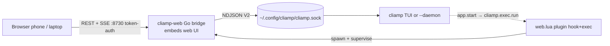

# cliamp-plugin-web — LAN web remote for cliamp

Date: 2026-10-12
Status: approved design (brainstorm session), pending implementation plan
Repo: `cliamp-plugin-web` (installs as plugin `web`; binary `cliamp-web`)

## 1. Goal

Control and monitor [cliamp](https://github.com/bjarneo/cliamp) from any browser on
the LAN: transport, now-playing, and the live playlist. Two scenarios, equal weight:

- **Couch remote**: cliamp runs its TUI on a desktop; a phone mirrors and drives it.
- **Headless**: cliamp runs `--daemon`; the web UI is a primary surface.

The TUI, media keys, and other IPC clients stay fully functional; every browser is
a live mirror of the same state.

Success criteria (v1): a phone on the same LAN can, within seconds of cliamp
starting, see what plays, move through the queue, seek, set volume, and toggle
shuffle/repeat — without touching the machine running cliamp beyond a one-time
URL entry.

## 2. Ground truth from cliamp (verified against upstream docs, 2026-10)

These facts decide the architecture; citations point at upstream `docs/`.

1. **A Lua plugin cannot serve HTTP.** The plugin sandbox has no raw sockets
   ("Raw socket access is not available"), and `cliamp.http` blocks private,
   loopback, link-local, multicast, and unspecified destinations after DNS and
   through redirects. `docs/plugins.md`, *Sandbox*.
2. **cliamp already exposes a full control API**: `~/.config/cliamp/cliamp.sock`,
   Unix socket, 0600, newline-delimited JSON, protocol version 2: `state.get`,
   `spectrum.get`, `operation.submit` (jobs), `subscribe` (event topics),
   stable error codes, 1 MiB frames. `docs/remote-control.md`.
3. **Retained core topics**: `runtime.state`, `runtime.playback`,
   `runtime.playlist`, `runtime.settings`, `runtime.job`. Position-only ticks do
   not create events; `revision`/`playlist_revision` guard stale writes via
   `if_revision` → `conflict`.
4. **Plugins can spawn allowlisted binaries** via `cliamp.exec.run` (per-user
   global `allowed_binaries`), killed automatically when cliamp exits.
5. **Daemon mode** exposes the same runtime/queue/job/event APIs; `theme`/`vis`
   are absent — feature-detect via `capabilities`.

## 3. Scope

### v1 (this spec)

- Transport: play/pause, stop, next, prev, seek (absolute, drag scrubber),
  volume (dB), shuffle, repeat (Off/All/One).
- Now playing: title/artist/album, position/duration, live-stream handling
  (duration 0 → indeterminate bar, seek disabled).
- Live playlist: list (cap 5000 rows, `truncated` flag), jump, remove,
  move up/down, clear; play-next sub-list: list, remove, clear.
- Multi-client mirroring, offline/resync signaling, token-auth LAN exposure.

### Explicitly cut from v1 (deferred, in order of likely value)

Cover art (needs tag parsing + a path-allowlisted file endpoint), EQ editor,
radio stations, provider browse/search, saved playlists/history, mDNS
advertisement, QR pairing, HTTPS (Caddy recipe documented instead), playback
speed control.

## 4. Architecture



Three units, one wire contract at each boundary:

| Unit | Responsibility | Depends on |
|---|---|---|
| `web.lua` (~120 LOC) | launch/supervise bridge, config passthrough, URL surfacing | cliamp plugin API |
| `bridge/` (Go) | IPC V2 client, snapshot cache, HTTP/SSE server, embedded UI | `cliamp.sock` only |
| `webui/` (Vue 3 + Reka UI) | SPA mirroring bridge state, posting commands | bridge REST/SSE |

The browser never speaks cliamp's protocol; the plugin never touches HTTP.

## 5. Component design

### 5.1 `web.lua` (plugin)

- `plugin.register{ name = "web", type = "hook", permissions = {"exec"} }`.
  No `control` permission: all playback control flows through the bridge over
  IPC, keeping the plugin's granted surface minimal.
- `app.start`: `cliamp.exec.run("cliamp-web", {"serve", "--port", port,
  "--lan"}, { on_stdout = funnel to cliamp.log.info, on_stderr = warn,
  on_exit = restart logic })`. Flags derive from `p:config()`: `port`
  (default 8730), `lan` (default false). Omit `--lan` when false.
- Restart policy: on nonzero exit, `cliamp.timer.after(2, restart)`, max 3
  restarts per cliamp session, then give up with a `plugins.log` line and
  `cliamp.message("web: bridge died, giving up")`.
- `p:command("url")`: read `status.json`, return URL + token (printed by
  `cliamp plugins call web url`). `p:command("status")`: alive/ports/offline.
- `app.quit`: no-op; cliamp kills exec children.
- URL surfacing: after `app.start` spawn, `timer.after(1, …)` reads
  `status.json` and shows `cliamp.message("web: http://<host>:<port>/?token=…",
  10)` when `lan` is on (no token in the TUI message; the token is available via
  `plugins call web url`).
- `enabled = false` via standard plugin config disables the whole thing.

### 5.2 Bridge (Go, `cmd/cliamp-web`)

Single static binary; subcommand `serve`; flags:
`--port` (8730), `--bind` (127.0.0.1; overridden to 0.0.0.0 by `--lan`),
`--lan`, `--data-dir` (`~/.local/share/cliamp/web`), `--verbose`.

Internal packages:

- `internal/ipc` — persistent NDJSON V2 client. One connection: on connect send
  `capabilities` + `subscribe` (`runtime.state`, `runtime.playback`,
  `runtime.playlist`, `runtime.settings`, `runtime.job`) + `state.get`. Handles
  frame reassembly (1 MiB cap), request/response correlation by `id`, job
  polling via `job.get` when a submit returns a non-final job, reconnect with
  capped exponential backoff, `system.overflow` → full resync. Missing socket
  (player down) is a normal state: keep retrying, report `player: offline`.
- `internal/snapshot` — pure reducer: runtime snapshot cache + queue cache +
  capabilities map. Queue refresh: prefetch on connect and on every
  `runtime.playlist` event (`queue.list` + `playnext.list`), truncate at 5000
  rows with `truncated: true`.
- `internal/server` — HTTP + SSE, auth, rate limit, static embed.

Startup contract: bridge generates a 256-bit token (`crypto/rand`) into
`<data-dir>/token` (0600) unless present, and writes `<data-dir>/status.json`
`{url, token, port, pid, started_at}` (0600). The plugin reads these with
`cliamp.fs.read`.

### 5.3 Browser↔bridge contract

Data flows one way in design: **GETs carry data, SSE carries signals.**

| Endpoint | Auth | Purpose |
|---|---|---|
| `GET /` | — | embedded SPA |
| `GET /api/health` | none | `{ok, player: "online"\|"offline"}` |
| `GET /api/state` | token | cached runtime snapshot (incl. `revision`, `playlist_revision`) |
| `GET /api/queue` | token | `{tracks, play_next, playlist_revision, truncated}` |
| `GET /api/capabilities` | token | cached `capabilities` result (UI feature-gating) |
| `GET /api/events` | token | SSE stream, see below |
| `POST /api/command` | `X-Token` header | `{op, params}` → `operation.submit`, waits for terminal job state (10 s cap), replies `{job: {state, error?, code?, snapshot?}}` |

SSE events (named): `state` (full runtime snapshot JSON), `playback`
(`{position, duration, state, track_title}`), `playlist` (signal only:
`{playlist_revision}` — client refetches `/api/queue`), `job` (final job
records), `resync` (client must refetch state + queue), `player`
(`{status: online|offline}`). Comment-line heartbeat every 15 s.

v1 ops forwarded: `toggle play pause stop next prev seek.absolute volume
shuffle repeat queue.jump queue.remove queue.move queue.clear playnext.remove
playnext.clear`. Queue-mutating calls pass `if_revision` from the client's
cached `playlist_revision`; `conflict` → HTTP 409 → client refetches.

IPC error code → HTTP: `invalid_params`→400, `not_found`→404,
`unknown_operation`→404, `conflict`→409, `unavailable`→503,
`internal_error`→500, player offline→503.

### 5.4 Web UI (Vue 3 + Vite + TypeScript + Reka UI)

- Build: `npm run build` → `webui/dist/`, committed artifact of CI builds only;
  `go:embed dist` in `internal/server` (placeholder `dist/index.html` checked
  in so `go build` never needs Node; `make ui` regenerates).
- Dev: Vite dev server proxies `/api` → `localhost:8730`.
- State: one `usePlayer()` composable — plain `reactive()` store holding
  snapshot + queue + capabilities; EventSource patches it; fetch wrapper posts
  commands and applies returned snapshots. No Pinia.
- Layout (mobile-first, dark retro theme, mono type, cliamp's winamp
  personality; Reka UI supplies behavior, our CSS supplies the look):
  - Now playing: title/artist/album; Reka Slider scrubber (keyboard-accessible,
    commits `seek.absolute` on release only; disabled + indeterminate when
    duration 0).
  - Transport row: prev, play/pause, next, stop; shuffle/repeat Reka Switch
    pair; Reka Slider volume in dB.
  - Queue: list (plain render; 5000-row cap keeps it bounded), current-row
    highlight, tap = jump, inline remove and ↑↓ move buttons; move buttons
    disabled with Reka Tooltip explaining shuffle conflict; Reka Collapsible
    for play-next with remove/clear.
  - Status: connection pill; Reka Toast for `player offline`, `resync`,
    409-conflict refreshes.
- Multi-client: no server-side per-client state; all clients are mirrors.

## 6. Security

Threat posture: cliamp's model treats the local user as trusted; a LAN port is
new surface and gets explicit, narrow guards.

- Default bind `127.0.0.1`. LAN requires opt-in: `[plugins.web] lan = true`.
- Token (256-bit, generated by bridge, 0600 on disk): required on all
  `/api/*` except `/api/health`. `POST` requires the custom `X-Token` header
  (cross-origin forms/plain fetches cannot set it ⇒ no CSRF without a CORS
  story). First page load may pass `?token=` once to seed `sessionStorage`.
  Constant-time comparison.
- DNS-rebinding guard: `Host` must equal the interface address contacted or an
  entry in `allowed_hosts` (`--allowed-hosts`, comma list). No CORS headers.
- Rate limit: token bucket per IP on `/api/command`, 20/s burst 40, 429 beyond.
- No filesystem serving in v1 (no cover art) ⇒ zero path-traversal surface.
  Static assets are embedded, not disk-backed.
- HTTPS out of scope; README documents a Caddy TLS-on-LAN recipe. Risk stated:
  token and metadata are cleartext on the LAN.
- Trust chain for execution: the binary must be in `allowed_binaries` — a
  dedicated binary name (`cliamp-web`) keeps the grant narrow (contrast:
  allowlisting `python3`/`node` would let any plugin abuse it).

## 7. Error handling

- Bridge loses `cliamp.sock` (crash/restart): retry loop (0.5 s → 5 s cap);
  browsers see `player: offline` on health + `player` SSE event; on reconnect:
  resubscribe, `state.get`, queue prefetch, then `resync` event to all SSE
  clients.
- SSE client lag at cliamp: cliamp sends `system.overflow` → bridge performs
  its own resync and forwards `resync` to browsers.
- Bridge started before player exists: normal offline mode (cannot actually
  happen under the plugin — `app.start` implies a live socket — but standalone
  `cliamp-web serve` must tolerate it).
- Job fails: bridge returns mapped HTTP code + `{code, error, detail?}`; the UI
  Toasts human-readable text and refetches on `conflict`.
- Protocol mismatch (version != 2 in hello/capabilities): log, `unavailable`,
  admin hint in `/api/health` (`"ipc_protocol_mismatch"`), UI shows upgrade
  hint.
- Bridge stdout stays quiet by default: exec output is capped at 4 MiB per
  plugin process; `--verbose` logs only, funneled to `plugins.log` by the
  plugin's `on_stdout`.

## 8. Configuration

```toml
# config.toml
[plugins.web]
enabled = true        # standard plugin key
port = 8730
lan = false           # true ⇒ bind 0.0.0.0
allowed_hosts = "cliamp.example.lan"   # optional passthrough

[plugins]
allowed_binaries = "cliamp-web"        # user adds, one line, documented
```

Standalone bridge users pass the same knobs as flags; flags win over defaults.

## 9. Testing

- **Go unit tests** (`internal/ipc` against a fake NDJSON V2 server): frame
  reassembly across arbitrary read boundaries; subscribe/ack handshake;
  request/response correlation; overflow→resync; reconnect + resubscribe;
  non-final job → `job.get` poll; `if_revision` passthrough and `conflict`
  mapping.
- **`internal/snapshot`**: reducer tested as a pure function (snapshot patch,
  queue truncation, revision bookkeeping).
- **`internal/server` (httptest)**: auth rejection (missing/wrong token, POST
  without `X-Token`), Host guard, rate-limit 429, error-code→HTTP mapping,
  SSE event fan-out to N clients.
- **Plugin**: manual smoke against real cliamp — install, `trust`, add
  `allowed_binaries`, launch, `cliamp plugins call web url`, `curl` from
  phone/curl with LAN IP.
- **Frontend**: manual browser smoke (desktop + mobile viewport); no JS unit
  suite in v1.
- **CI** (GitHub Actions): `go vet`, `go test`, `npm run build` (webui),
  cross-build `linux/amd64` + `linux/arm64`, release artifacts with checksums.

## 10. Repo layout

```
cliamp-plugin-web/
  web.lua                  # plugin entry (repo root = installer convention)
  go.mod                   # module; embeds webui/dist
  cmd/cliamp-web/main.go   # serve subcommand, flags
  internal/ipc/            # V2 NDJSON client
  internal/snapshot/       # cache + reducer
  internal/server/         # HTTP/SSE, auth, rate limit, go:embed
  webui/                   # Vue 3 + Vite + TS + Reka UI
    index.html src/… dist/ # dist has placeholder; make ui regenerates
  Makefile                 # build: ui + go + test + package
  PKGBUILD                 # Arch packaging
  docs/                    # README install, Caddy recipe, IPC notes
  .github/workflows/ci.yml release.yml
```

Install (documented, exactly):

1. `cliamp plugins install <user>/cliamp-plugin-web`
2. install the `cliamp-web` binary (GitHub release, or AUR/PKGBUILD)
3. `allowed_binaries = "cliamp-web"` + `cliamp plugins trust web`
4. start cliamp → message shows the URL; open it.

## 11. Invariants

- Exactly one IPC connection per bridge; browsers never multiply into
  `cliamp.sock`.
- SSE carries small signals; bulk data comes from GET endpoints backed by the
  bridge cache (cliamp 1 MiB frame cap is never a browser-facing limit).
- Every destructive queue mutation carries `if_revision`; no client may send
  queue edits without it.
- The plugin's only permission is `exec`; the bridge's only privilege is the
  socket it is pointed at plus its own 0600 data dir.
- All browsers converge on the same state within one `resync` cycle after any
  disconnect, by refetching `GET /api/state` + `/api/queue` (per V2 overflow
  rules).
