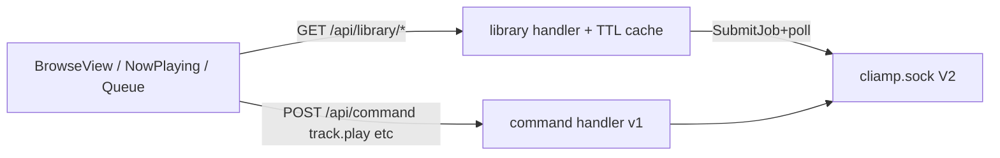

# cliamp-plugin-web v2 — library browsing, search, Now Playing page

Date: 2026-10-12
Status: approved design (brainstorm session, inline), pending implementation plan
Depends on: v1 spec (`2026-10-12-cliamp-web-design.md`), shipped at `fca5e44`.

## 1. Goal

Make the phone remote a way to *choose* music, not only steer what's already queued:
browse and search every provider the player knows, act on results (play now /
queue next / load playlist / play album), and give playback its own full-screen
page. v1 surfaces (queue, transport, SSE contract, auth, plugin) are unchanged.

Success looks like: on a phone, without touching the terminal, go from
"Browse → Navidrome → Albums → Metallica → *Load*" to hearing the album, and
from "search *lofi* on ytmusic" to a queued track.

## 2. Ground truth from cliamp V2 (verified by live probes against v2.0.1, 2026-10-12)

Every shape below was probed against the running player — where these disagree
with upstream docs, these win.

| op | params (exact spelling) | result |
|---|---|---|
| `provider.list` | — | `{ok, providers:[{key,name,searchable,catalog?,browse_albums?,browse_artists?}]}` |
| `provider.playlists` | `{provider, limit?, offset?}` | `{ok, total, playlists:[{id,name,provider,track_count}]}` |
| `provider.albums` | `{provider, limit?, offset?}` | `{ok, total, albums:[{id,name,artist,artist_id,year,track_count,genre}]}` |
| `provider.artists` | `{provider, limit?, offset?}` | `{ok, total, artists:[{id,name,album_count}]}` |
| `provider.catalog` | `{provider}` | `{ok, total, playlists:[{id,name,provider,favoritable?}]}` (radio stations) |
| `provider.album_tracks` | `{provider, album, offset?, limit?}` | `{ok, tracks:[…]}` |
| `provider.tracks` | `{provider, id, offset?, limit?}` | `{ok, tracks:[…]}` (`id` = artist id) |
| `provider.search` | `{provider, query, limit?, offset?}` | `{ok, total, tracks:[{title,artist,path,duration_secs,stream}]}` |
| `provider.load` | `{provider, playlist}` | job; replaces queue with the playlist |
| `provider.load_album` | `{provider, album}` | job; replaces queue with the album |
| `track.play` | `{track, if_revision}` | play a supplied track object |
| `track.queue` | `{track, if_revision}` | queue a supplied track next |
| `url.load` | `{path, play}` | resolve/append a URL |

- Provider param name is **`provider` inside `params`** — envelope-level placement
  fails with `unknown provider ""` (the `cliamp remote call <op> '<json>'` CLI puts
  args envelope-level, which is why the CLI spelling looks different; do not copy it).
- Observed error shapes: `internal_error` + `detail: "unknown provider \"\""`;
  `internal_error` + `detail: "navidrome: missing parameter: 'id' (code 10)"`;
  navidrome outage surfaces as `internal_error` with a `navidrome: …` detail.
- Installed providers: `radio` (catalog), `local`, `navidrome` (browse_artists,
  browse_albums), `yt`, `youtube`, `ytmusic` — capability flags come from
  `provider.list`, never hardcoded.
- **No artwork URL anywhere** in snapshot or provider track payloads
  (title/artist/path/duration_secs/stream only). Artwork is explicitly out of
  v2 scope (§4).
- Jobs for provider ops are async (`"async": true` in capabilities); the bridge
  already polls via `job.get` with envelope-level `job_id`.
- No library-change events exist; browse data freshness is TTL-bounded only.

## 3. Scope

### v2 (this spec)

- **Browse**: provider switcher (from `provider.list`), capability-adaptive tabs
  (Playlists / Albums / Artists / Catalog), paginated infinite scroll, drill-down
  to track lists, Reka `Tabs`/chips.
- **Search**: per-provider, debounced 300 ms; results are tracks; each row:
  play-now (`track.play`) / queue-next (`track.queue`).
- **Actions**: `track.play`, `track.queue` (with `if_revision` from current
  snapshot), `provider.load` and `provider.load_album` behind `window.confirm`
  (they replace the queue), `url.load` exposed only via `POST /api/command`
  passthrough (no dedicated UI button in v2).
- **Now Playing page**: dedicated full-screen view — typographic hero (no art),
  full-width scrubber, large transport/volume/shuffle/repeat, "Up next" (first 5
  queue rows, tap-to-play), plus a persistent mini player bar on the other views.
- **Tabbed shell**: bottom tab bar `Now Playing · Queue · Browse`; Queue view
  keeps v1 QueueList + PlayNextList.

### Explicitly out of v2

- Album art (no data from the player; fetching from Navidrome would put provider
  credentials in the bridge — rejected).
- Favorites/heart (`provider.favorite` exists; deferred — needs per-provider
  semantics probing).
- History, lyrics, EQ, speed, mono screens (ops exist; deferred).
- Multi-user/multi-token, HTTPS in-bridge, mDNS discovery.
- Virtualized lists (infinite scroll is sufficient at observed library sizes:
  222 playlists, 164 artists).

## 4. Architecture

Unchanged from v1: one bridge, two IPC connections, GETs carry data / SSE
carries signals, commands via `POST /api/command`. v2 adds one bridge
subcomponent and restructures the UI shell:



No new IPC connection, no new auth path, no SSE contract change.

## 5. Component design

### 5.1 Bridge: `internal/server/library.go`

New handler set on the existing mux, all under `protect` (HostGuard + token)
and the existing rate limiter:

```
GET /api/library/providers                       → provider.list      TTL 300 s
GET /api/library/{provider}/playlists?offset&limit
GET /api/library/{provider}/albums?offset&limit
GET /api/library/{provider}/artists?offset&limit
GET /api/library/{provider}/catalog
GET /api/library/{provider}/album/{id}/tracks?offset&limit
GET /api/library/{provider}/artist/{id}/tracks?offset&limit
GET /api/search/{provider}?q&offset&limit        → provider.search    no cache
```

- Each request → `SubmitJob` → poll (existing machinery) → upstream `result`
  passed through verbatim (UI consumes player shapes directly; bridge adds no
  schema).
- Query params validated: `offset ≥ 0`, `1 ≤ limit ≤ 200` (default 50);
  violations → 400 `invalid_request`. Path provider key is passed as
  `params.provider` unvalidated beyond non-empty (upstream error is the
  authority).
- Cache: in-memory map keyed by full path; TTL injected as a duration for
  tests; entries dropped wholesale after TTL (no LRU needed at this scale —
  cap 128 entries, oldest evicted).
- Job wait timeout: 30 s → `504 {"ok":false,"error":"job_timeout"}`. Upstream
  `internal_error` → `502` with the player's `detail` string carried through.
- `web.lua`, SSE hub, snapshot cache, queue endpoints: untouched.

### 5.2 Web UI shell

- `App.vue`: `view = ref<'nowplaying'|'queue'|'browse'>` (default `nowplaying` —
  the app opens on the playback page),
  bottom tab bar, mini player bar (`MiniPlayer.vue`) visible on all views except
  Now Playing; tapping mini → Now Playing. No router dependency.
- `NowPlayingHero.vue`: absorbs seek/volume/shuffle/repeat/transport logic from
  v1 `NowPlaying`/`TransportBar` (those shrink or fold in), hashed-gradient
  backdrop (`background: linear-gradient` from a 3-value hash of the title),
  Up-next list (rows reuse QueueList row styling, tap → `queue.play`).
- `BrowseView.vue` + `store.browse`:
  `{provider, tabs[], tab, list, total, offset, loading, error, stack, search}`;
  tab set derived from capability flags of the selected provider
  (`playlists`+`catalog` for radio; `playlists`/`albums`/`artists` for
  navidrome; search-only otherwise). Infinite scroll: `IntersectionObserver`
  sentinel fetches `offset+50`. Drill stack: push `{kind,id,title}`, back pops.
- Track rows (`TrackRow.vue`): ▶ → `track.play {track, if_revision}`,
  ➕ → `track.queue {track, if_revision}` via `runCommand` + `withRevision`.
- Confirm before `provider.load` / `provider.load_album`: `window.confirm`
  naming what replaces the queue (same pattern as `queue.clear`).

### 5.3 Fake player

`wiring_test.go` fake gains the provider ops above with exact param names,
async job transitions, pagination, and both observed error shapes; fixtures:
two providers with different capability flags, ~120 playlists, 3 albums, 2
artists. The standalone copy used for browser smokes is built from the same
source file.

## 6. Security

Nothing new listens; new endpoints inherit v1 guards verbatim: HostGuard,
constant-time token (header for any method, query allowed for GET — browse
URLs are data-only reads), 20/s limiter. Provider credentials stay in cliamp;
the bridge never talks to providers directly.

## 7. Error handling

- Upstream provider down → 502 + `detail`; Browse view shows an inline retry
  banner (data-specific), not a global toast storm.
- `job_timeout` → 504; UI offers Retry on the affected list only.
- Offline player mid-browse: existing offline banner covers it; in-flight
  library GETs fail as 502 (`detail: "player offline"`) — lists keep their
  last content with the banner above.
- Queue-replacement actions (`provider.load*`) follow the existing
  `if_revision`-free flow: they are jobs like any op; `playlist` SSE event then
  drives the queue refetch (v1 contract).

## 8. Testing

- **Go** (table-driven, fake player): param pass-through per endpoint;
  limit/offset validation; unknown-provider 502 + detail passthrough;
  job_timeout 504 (injectable timeout); cache: second call within TTL makes
  zero upstream requests, post-TTL call makes one; middleware (auth/limiter)
  coverage extended to one library path.
- **UI**: `vue-tsc` strict; browser acceptance vs fake player — provider
  switching changes tab set; infinite scroll page 2; ▶/➕ actions toast +
  reflect in Queue; load-playlist confirm replaces queue; Now Playing hero
  tracks SSE; back-stack pops correctly.
- **Live**: phone against real Navidrome + ytmusic (manual).
- v1 regression suite (incl. `TestPlaylistSignalFollowsCacheSwap`) stays green
  untouched.

## 9. Invariants (additions to v1 §11)

- `provider` always rides inside `params`, never the envelope.
- Browse listings are always player-shaped: the bridge forwards `result`
  untouched (no renaming, no aggregation).
- Queue-replacement ops always confirm in the UI before submitting.
- The bridge never contacts music providers; all library data flows through
  `cliamp.sock`.
